# Лабораторная работа №3. Bubble

## Краткое описание

## Ссылка на dev-версию приложения
https://my-app-261015-85788.bubbleapps.io/version-test/?debug_mode=true

## Часть 1. Промпт

```Создай приложение на тему «Трекер привычек»
Пусть этот сайт будет требующий регистрацию
Страницу обязательно создай по структуре header + body + footer
Обязательно укажи в заготовке следующую строку: «ТВП: Дубровщик»
Добавь несколько интерактивных элементов (реализующих CRUD)
```

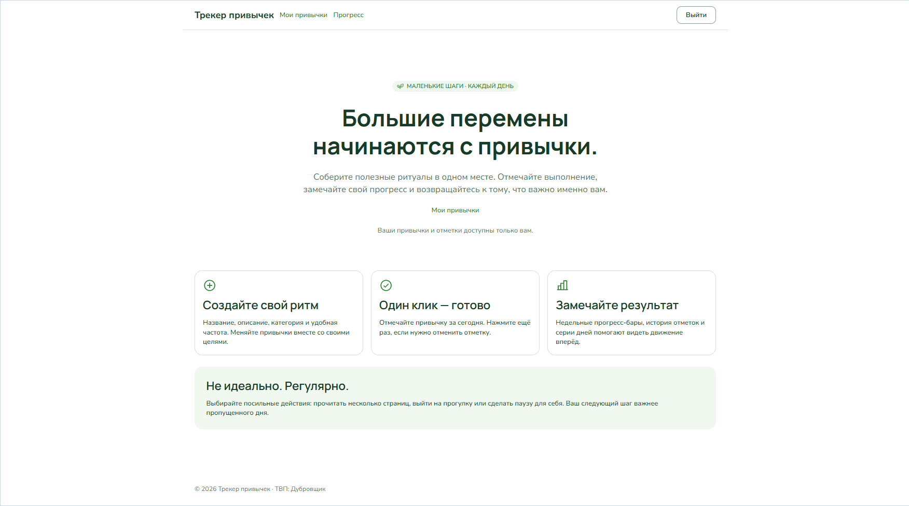

## Часть 2. Исследование Build Guides

### Изученные Build Guides

1. **«Отображение списка привычек» (EASY)**
2. **«Удаление привычек» (EASY)**
3. **«Страница с заголовком, телом и подвалом» (EASY)**
4. **«Регистрация и вход в систему» (MODERATE)**
5. **«Создание и редактирование привычек» (MODERATE)**
6. **«Интерактивные элементы для отслеживания прогресса» (CHALLENGING)**

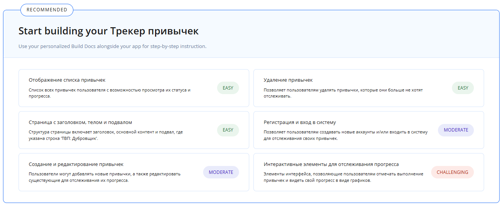

### Что показалось полезным

- Идея **двух связанных сущностей** (привычка + запись о её выполнении) — 
  это позволяет хранить историю и считать прогресс по дням.
- Использование **Progress Bar** для визуализации недельного прогресса.
- Счётчик **серии дней подряд** (streak) как мотивационный элемент.

### Что взяли в своё приложение

Приложение было сгенерировано AI-агентом по промпту из Части 1. При сверке
с рекомендациями Build Guide выяснилось, что **все ключевые идеи гайда
в приложении уже реализованы**:

- две связанные сущности: `Привычка` и `Отметка выполнения` (эквивалент `Habit` и `ProgressRecord`);
- Progress Bar в каждой карточке привычки («N из M», процент выполнения);
- интерактивные отметки по дням недели (Пн–Вс);
- счётчик серии дней подряд («N дней подряд»).

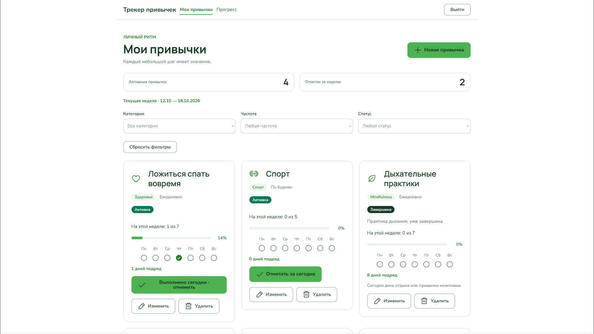
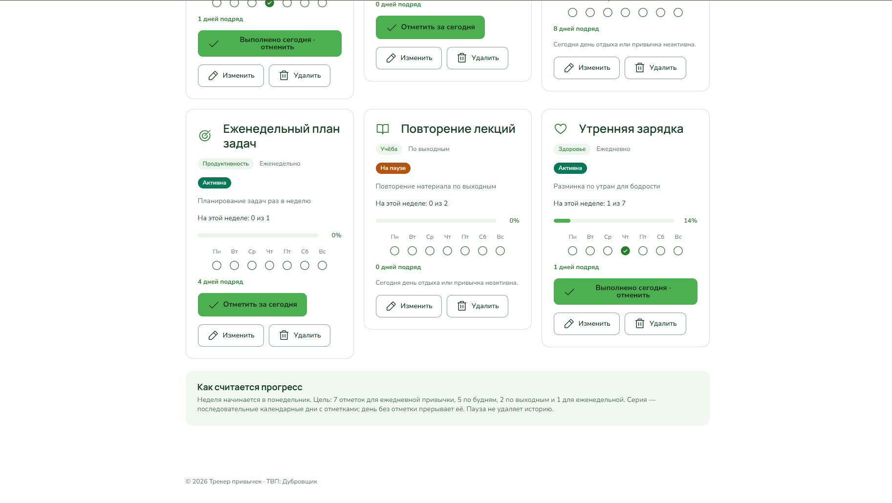

## Часть 3. Ручная доработка UI

### 3.1. Изменение текста заголовка

На странице `habits` в Design был изменён текст элемента `Heading`:
в исходный заголовок «Мои привычки» добавлено имя — получилось
«Мои привычки — Екатерина». Фамилия, как и требовалось, осталась
в футере в строке «ТВП: Дубровщик» (из промпта Части 1).

### 3.2. Global variable для цвета

В разделе **Global → Variables** создана переменная типа **Color**
с именем `my test color`. Значение — розовый цвет, используемый
в оформлении приложения.

Переменная применена к элементу: фон кнопки «Отметить за сегодня»
(`Toggle Button`) на странице `habits` теперь берёт цвет
из `my test color`, а не из хардкод-значения. Благодаря этому
смена цвета в одном месте автоматически меняет его на всех
элементах, где применена переменная.

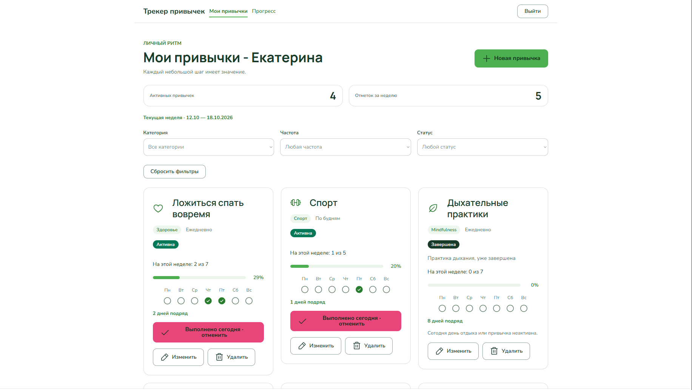

### 3.3. Новый стиль

Создан новый стиль для кнопки (Button style). В настройках стиля
в качестве цвета фона используется **та же переменная
`my test color`**, а не статичное значение. Стиль применён
к кнопкам на странице — «Отметить за сегодня», «Добавить заметку»,
«Редактировать» и другим.

Таким образом, изменение `my test color` в Global Variables
автоматически влияет на все кнопки, использующие стиль.

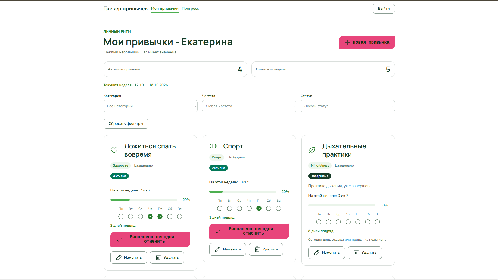

### 3.4. Готовый компонент из библиотеки

Открыта библиотека **Drag & drop UI components**. Из неё выбран готовый
компонент и перетащен на страницу приложения. Компонент настроен
под общую тему приложения (цвета, шрифты, отступы).

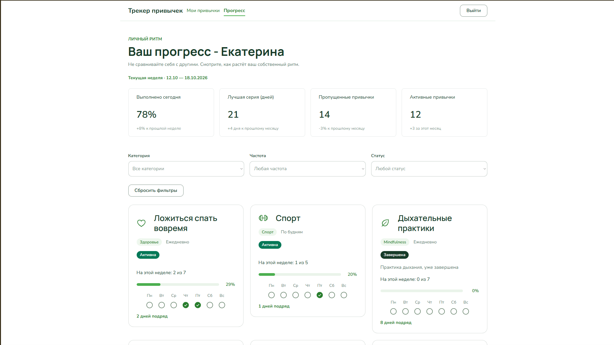

## Часть 4. Data и Workflows

### 4.1. Data: новая сущность

С помощью AI-агента Bubble была сгенерирована новая сущность
**«Заметка к привычке»** (`Заметка К Привычке`).


| Поле          | Тип                    | Назначение                              |
|---------------|------------------------|-----------------------------------------|
| `title`       | text                   | Заголовок заметки                       |
| `note_date`   | date                   | Дата заметки                            |
| `is_important`| yes/no                 | Признак важности                        |
| `habit`       | Привычка (link)        | Ссылка на связанную привычку            |

Также в сущности автоматически присутствуют встроенные поля
`Creator`, `Created Date`, `Modified Date`, `Slug`.

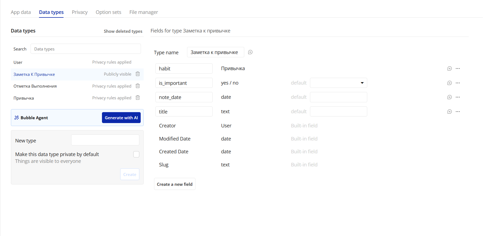

Через **App Data** вручную добавлены 2 записи:

1. «На следующую неделю выделить 3 главные задачи» — связана с привычкой, важная.
2. «После утренней зарядки легче сосредоточиться» — связана с привычкой, важная.

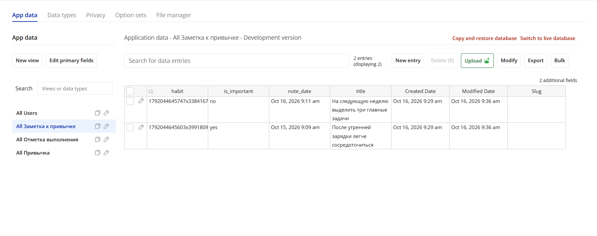

### 4.2. Workflows: CRUD

Для сущности «Заметка к привычке» реализован полный CRUD.
UI создан с помощью AI-агента на отдельной странице `notes`.

**Страница `notes`:** список заметок в RepeatingGroup
(`Search for Заметка К Привычке`, сортировка по `note_date`),
кнопка «+ Добавить заметку», в каждой карточке — кнопки
«Редактировать» и «Удалить».

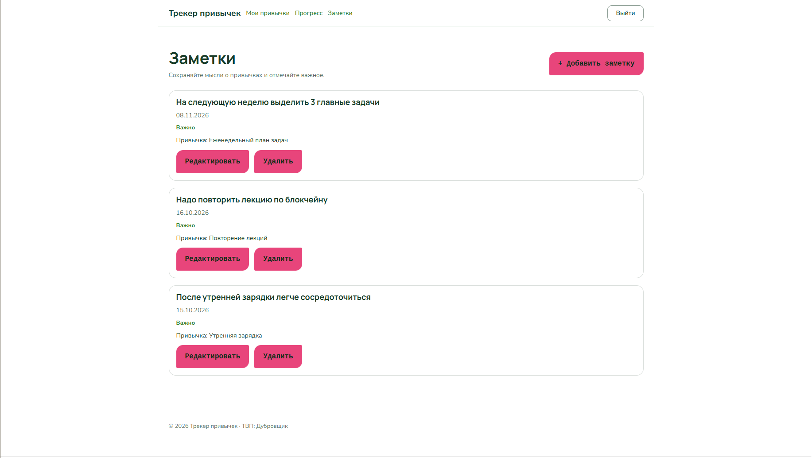

**Create.** Кнопка «+ Добавить заметку» открывает popup с формой
(`title`, `note_date`, `is_important`, `habit`). Кнопка «Сохранить»
внутри popup создаёт новую запись типа «Заметка к привычке»
и закрывает popup.

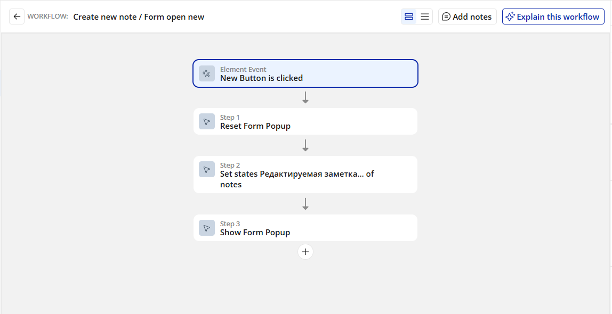

**Read.** Список заметок отображается через RepeatingGroup
с data source `Search for Заметка К Привычке`.

**Update.** Кнопка «Редактировать» в карточке открывает popup
с формой, заполненной данными текущей заметки. Кнопка «Сохранить»
обновляет запись.

**Delete.** Кнопка «Удалить» в карточке открывает popup
подтверждения. Кнопка «Удалить» внутри popup удаляет запись.

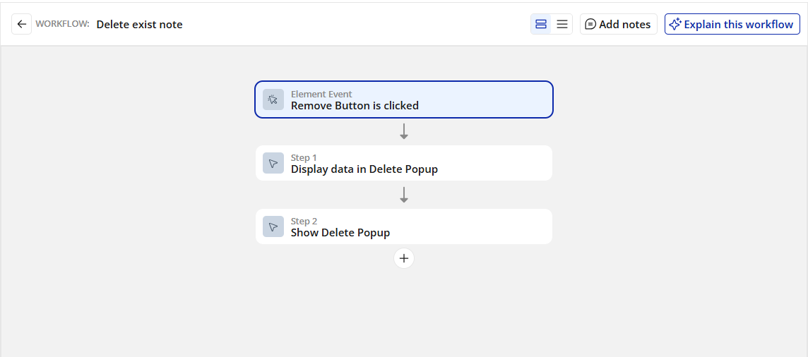


## Использованные AI-промпты
```
Создай приложение на тему «Трекер привычек»
Пусть этот сайт будет требующий регистрацию
Страницу обязательно создай по структуре header + body + footer
Обязательно укажи в заготовке следующую строку: «ТВП: Дубровщик»
Добавь несколько интерактивных элементов (реализующих CRUD)
```

```
Создай новую страницу "Заметки" (notes) для моего приложения-трекера привычек.

На этой странице реализуй полный CRUD для уже существующей сущности
"Заметка к привычке" (поля: title — text, note_date — date, is_important — yes/no, habit — ссылка на сущность "Привычка").

Структура страницы:
- header + body + footer, как на остальных страницах приложения;
- заголовок страницы "Заметки" с подзаголовком;
- кнопка "+ Добавить заметку" — открывает всплывающую форму (popup);
- RepeatingGroup со списком заметок, data source = Search for "Заметка к привычке", отсортированный по note_date (убывание);
- в каждой карточке заметки отображать: title, note_date, is_important (например,
  как бейдж "Важно" если yes), название связанной привычки (habit's Название);
- в каждой карточке — кнопки "Редактировать" и "Удалить".

Workflows (каждое действие — отдельный workflow):
1. CREATE: при нажатии "+ Добавить заметку" открывается popup с формой (title, note_date,
   is_important, habit). Кнопка "Сохранить" внутри popup создаёт новую запись "Заметка к привычке" и закрывает popup.
2. READ: список заметок отображается через RepeatingGroup с data source
   Search for "Заметка к привычке".
3. UPDATE: при нажатии "Редактировать" открывается popup с формой, заполненной данными текущей заметки. Кнопка "Сохранить" обновляет запись.
4. DELETE: при нажатии "Удалить" открывается popup подтверждения. Кнопка "Удалить" внутри popup удаляет запись.

Все кнопки оформи в том же стиле, что и на странице habits (зелёная тема).
Добавь строку "ТВП: Дубровщик" в footer.
```
## Освоенные элементы и workflows

### Элементы (Design / UI)

- **Header / Body / Footer** — структура страницы (header + body + footer,
  как требовалось в промпте).
- **Group / Container** — группировка элементов, адаптивная вёрстка.
- **Text / Heading** — заголовки и текстовые блоки (заголовок страницы,
  описания привычек, тексты карточек).
- **Button** — кнопки действий («Отметить за сегодня», «Изменить»,
  «Удалить», «+ Добавить заметку», «Сохранить»).
- **Icon** — иконки привычек и элементов интерфейса.
- **Input / Multiline Input** — поля ввода в формах создания
  и редактирования (title, note_date, is_important, habit).
- **Dropdown** — фильтры на странице `habits` (Категория, Частота, Статус).
- **Checkbox / Toggle** — выбор `is_important` в форме заметки.
- **RepeatingGroup** — списки привычек (`habits`) и заметок (`notes`)
  с data source через `Search for ...`.
- **Popup** — всплывающие окна для форм создания / редактирования
  и подтверждения удаления.
- **Progress Bar** — визуализация недельного прогресса в карточке привычки.
- **Custom State** — хранение временных состояний на странице
  (например, для управления видимостью элементов).
- **Plugin element `Confetti Celebrator`** — элемент плагина
  Confetti Celebration, запускающий анимацию конфетти.

### Workflows

- **Page is loaded** — начальная инициализация страницы.
- **Button is clicked → Create a new thing** — создание новой привычки
  и новой заметки.
- **Button is clicked → Make changes to a thing** — редактирование
  существующих записей.
- **Button is clicked → Delete a thing** — удаление привычек и заметок.
- **Show element / Hide element** — управление видимостью popup
  и элемента плагина.
- **Set state** — установка custom state страницы.
- **Plugins → Show Confetti** — действие плагина Confetti Celebration,
  добавленное в workflow отметки привычки (`Check`).
- **Conditions** — условное выполнение действий (например, конфетти
  запускается только при отметке, но не при отмене).

## Выводы
Все круто. спасибо.