# Отчёт по лабораторной работе №4. n8n

**Способ установки:** Docker Desktop (образ `n8nio/n8n:latest`)

**Команда запуска:**
```
docker volume create n8n_data

docker run -it --rm \
 --name n8n \
 -p 5678:5678 \
 -e GENERIC_TIMEZONE="Europe/Minsk" \
 -e TZ="Europe/Minsk" \
 -e N8N_ENFORCE_SETTINGS_FILE_PERMISSIONS=true \
 -e N8N_RUNNERS_ENABLED=true \
 -v n8n_data:/home/node/.n8n \
 n8nio/n8n
```

## Краткое описание выполненного

В ходе работы были собраны и задеплоены следующие workflow:

| № | Файл | Что демонстрирует |
|---|---|---|
| 2.1 | flow-01-manual-set.json | Manual Trigger → Set → Code: базовый поток |
| 2.2 | flow-02-code.json | Code node: JS-логика (let/const, if/else, for, массивы, объекты) |
| 2.3 | flow-03-if.json | IF node: ветвление по payload |
| 2.4 | flow-04-set.json | Set node: Set topic, timestamp, payload |
| 2.5 | flow-05-http.json | HTTP Request: запрос к публичному API (chucknorris.io) |
| 2.6 | flow-06-schedule.json | Schedule Trigger: запуск по расписанию |
| 3.1 | flow-09-redis.json | Redis Set/Get: создание и чтение ключа |
| 3.2 | flow-10-redis.json | Redis Delete/Get: удаление и проверка отсутствия ключа |
| Ачивка 8 | flow-12-google-webhook.json | Webhook → Google Sheets: логирование запросов в таблицу |
| Ачивка 9 | flow-11-github.json | GitHub API: безопасное чтение README.md |


## Использованные AI-промпты (ключевые примеры)

1. **Генерация кода Code node для 2.2:**
   > «Напиши код для ноды Code в n8n, который использует let/const, if/else, цикл for, массив и объект. Функция должна возвращать объект с полем payload.»

2. **Настройка IF node для 2.3:**
   > «Как в n8n настроить ноду IF, чтобы она проверяла поле payload на соответствие строке "success" и пускала по ветке true, если совпадает?»

3. **Работа с Redis (3.1):**
   > «Как в n8n настроить credentials для Redis на localhost (host.docker.internal, port 6379) и использовать ноды Redis Set и Redis Get?»

4. **Чтение файла из GitHub (Ачивка 9):**
   > «Как в n8n через ноду GitHub получить содержимое файла README.md из репозитория и декодировать его из Base64 в обычный текст с помощью ноды Code?»
   
5. **Настройка Webhook для Ачивки 8:**
   > «Как в n8n настроить ноду Webhook, чтобы она принимала GET-запрос с параметром text в URL, и как потом вытащить этот текст в следующей ноде через expression `{{ $json.query.text }}`?»

6. **Авторизация Google Sheets (Ачивка 8):**
   > «Как получить Client ID и Client Secret в Google Cloud Console для подключения Google Sheets OAuth2 API в n8n, и какой Redirect URI нужно указать?»

## Освоенные ноды

**Триггеры:**
- `Manual Trigger` — ручной запуск workflow
- `Schedule Trigger` — запуск по расписанию
- `Webhook` — прием входящих HTTP-запросов (GET/POST)

**Функциональные (Core):**
- `Set` — установка и изменение полей
- `Code` — выполнение произвольного JS-кода
- `IF` — ветвление по условиям
- `NoOp` — узел-заглушка

**Сетевые и хранилища (Network & Storage):**
- `HTTP Request` — исходящие HTTP-запросы
- `Redis` — операции Set, Get, Delete
- `GitHub` — интеграция с API (чтение файлов)
- `Google Sheets` — добавление строк в таблицу (Append Row)

## Скриншоты

### Часть 1. Установка

- 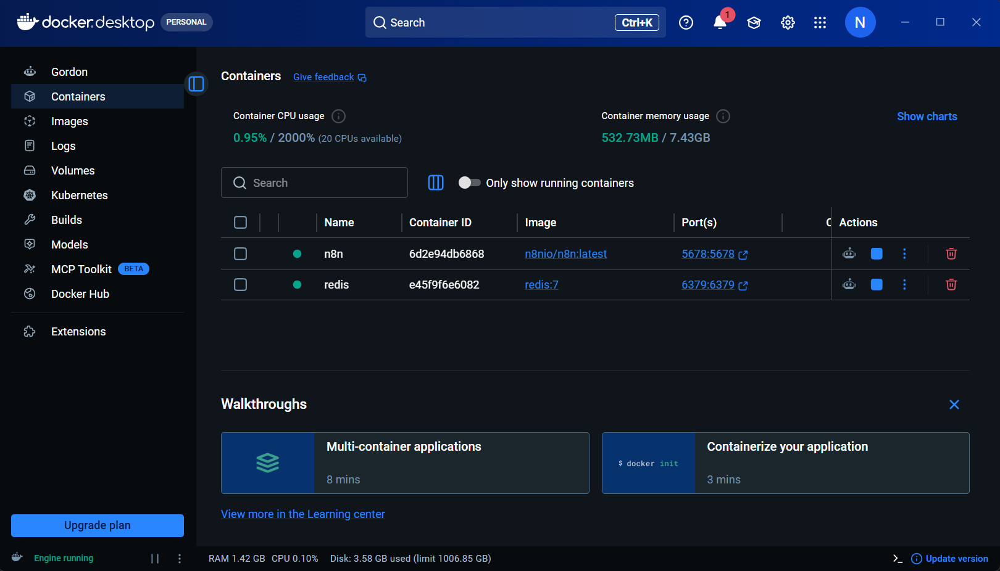

### 2.1. Manual → Set → Code

- 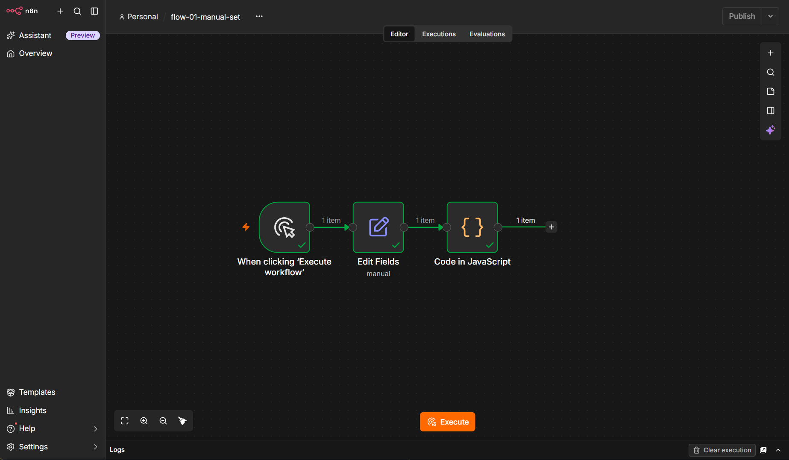

### 2.2. Code

- 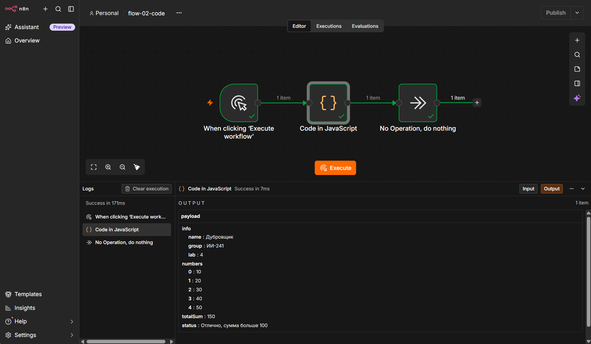

### 2.3. IF

- 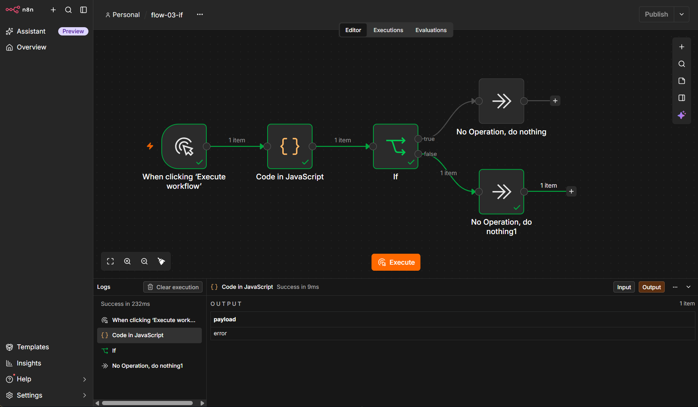

### 2.4. Set

- 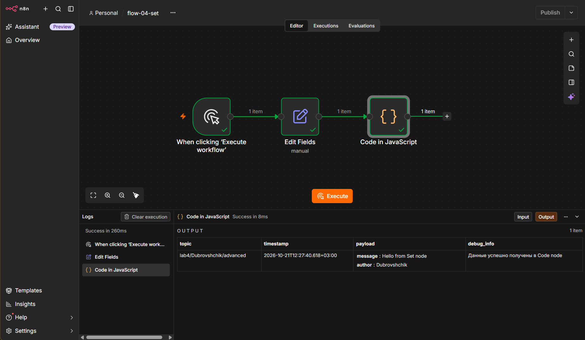

### 2.5. HTTP Request

- 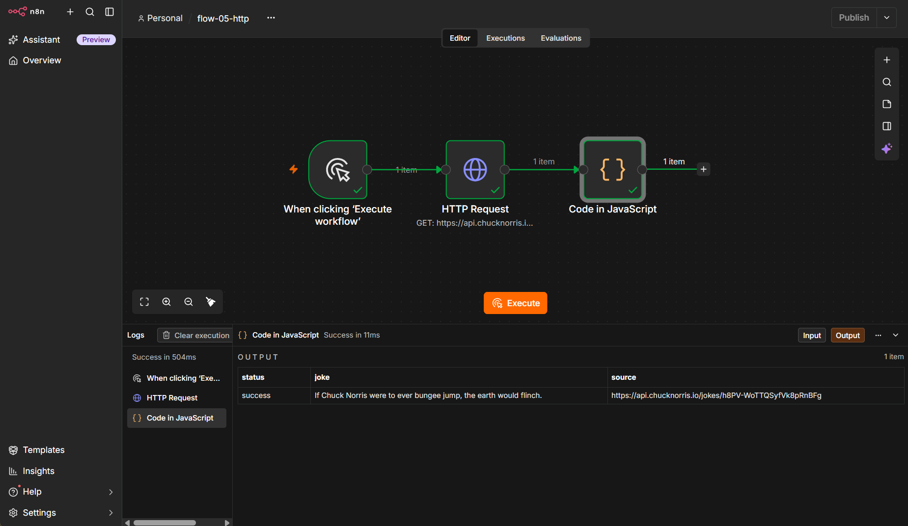

### 2.6. Schedule

- 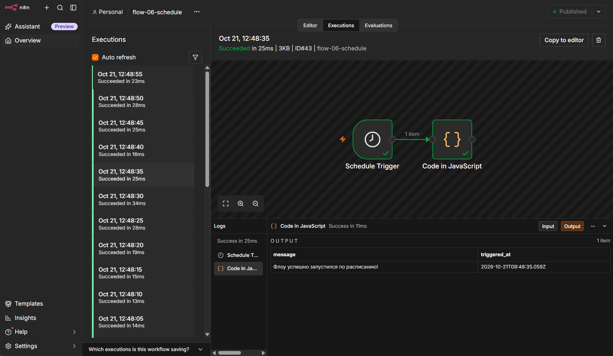

### 3.1. Redis (Set/Get)

- 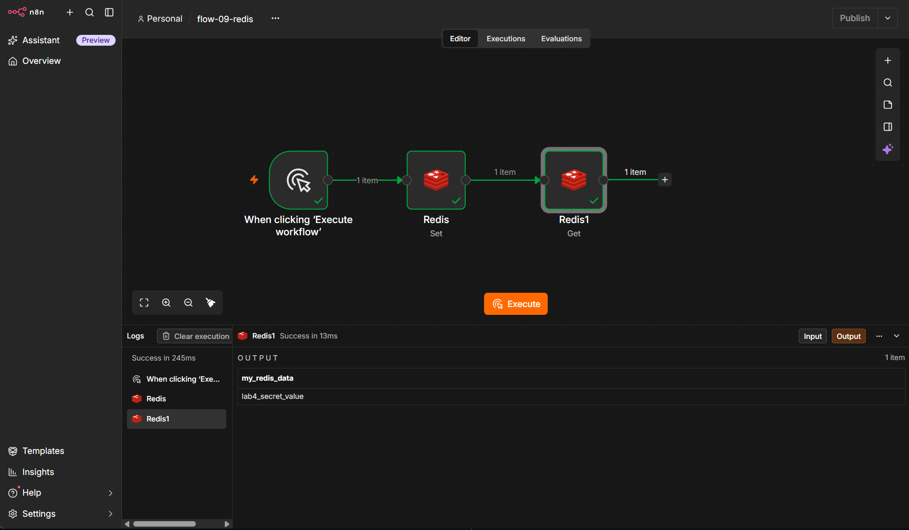

### 3.2. Redis (Delete/Get)

- 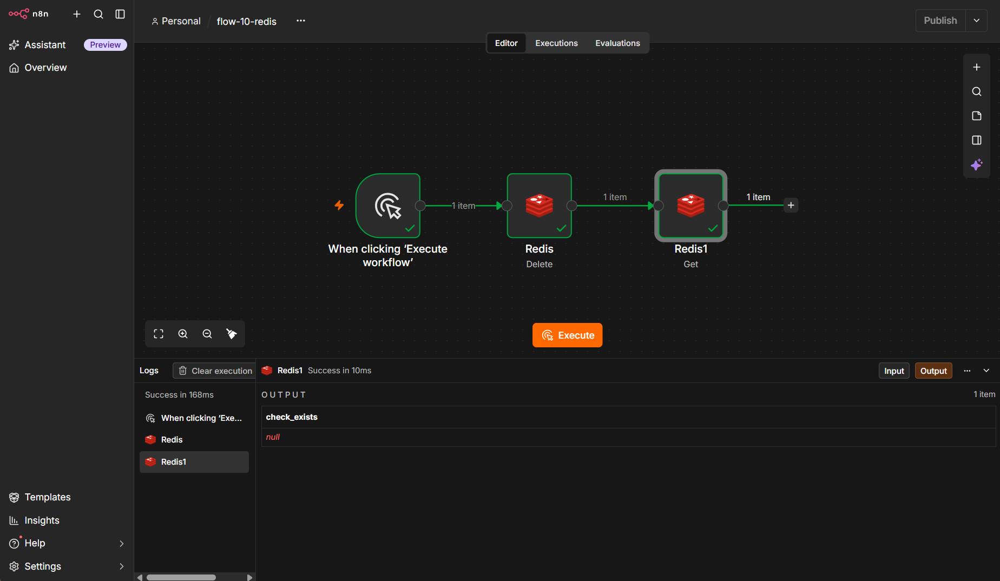

### Ачивка 8. Webhook → Google Sheets

- 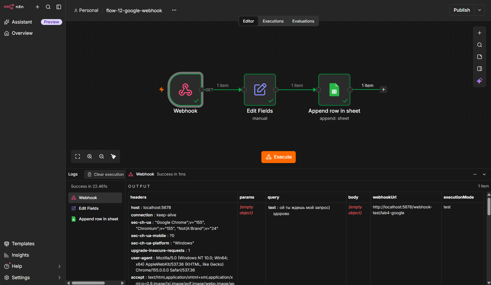
- 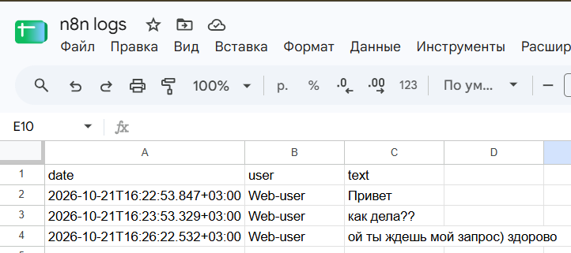

### Ачивка 9. GitHub API

- 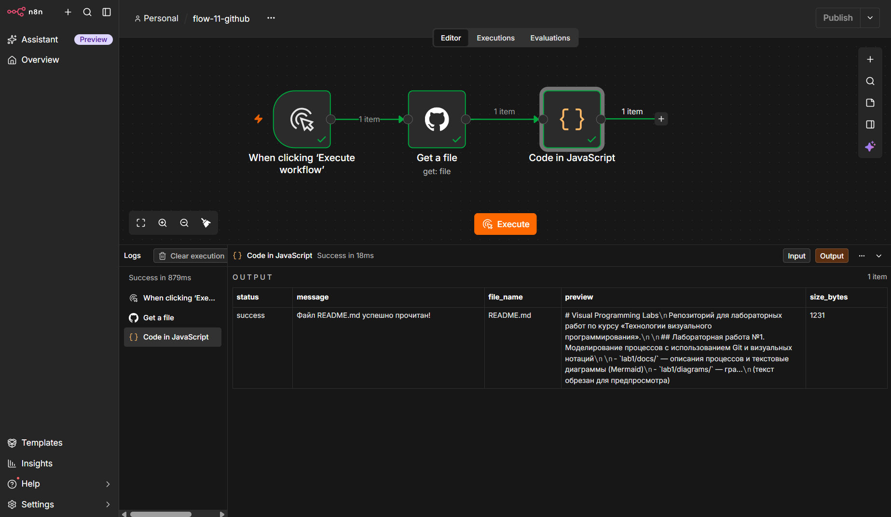

## Выводы

В ходе выполнения лабораторной работы я освоила n8n как low-code платформу автоматизации. Разобралась с запуском приложений через Docker Desktop, настройкой переменных окружения и volumes для сохранения данных. 

Изучила базовые и продвинутые ноды, научилась передавать данные между ними, настраивать ветвление (IF) и выполнять JavaScript-код (Code). Отдельно разобралась с работой Redis через ноды n8n. 

В рамках ачивки 8 я настроила связку Webhook и Google Sheets. Самым сложным здесь было пройти авторизацию в Google Cloud Console и получить OAuth-ключи, чтобы n8n получил доступ к таблицам. Но это дало понимание, как в реальной жизни приложения обмениваются данными через API и вебхуки.

В рамках ачивки 9 настроила интеграцию с GitHub через Personal Access Token. Самым интересным было реализовать безопасное чтение файла (`README.md`) из репозитория. Я узнала, что GitHub отдаёт файлы в формате Base64, и научилась декодировать их обратно в текст с помощью JavaScript (`Buffer`). 

Работа с n8n показала, как можно быстро и визуально строить сложные интеграции, не тратя время на написание бэкенда с нуля. Опыт работы с Docker и API поможет мне в дальнейшем при создании собственных автоматизаций.

моя оценка: все было круто 