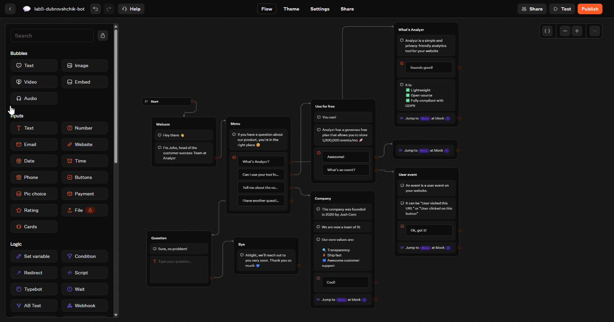
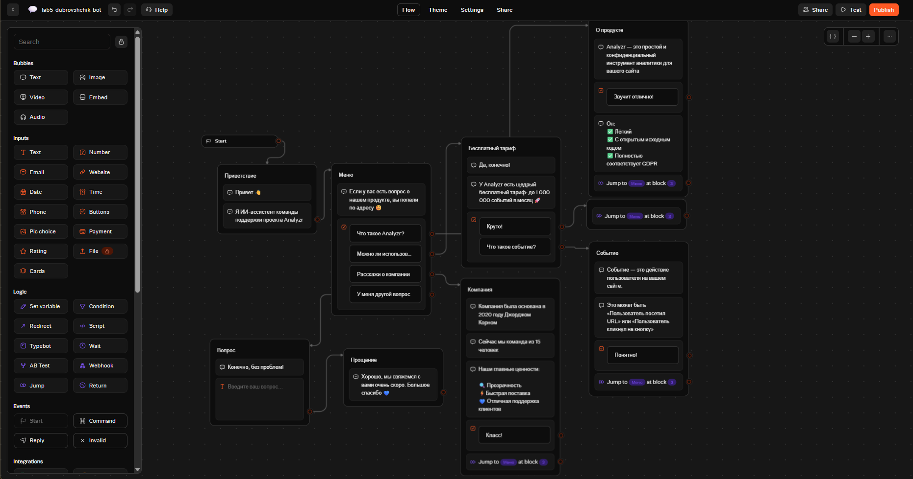
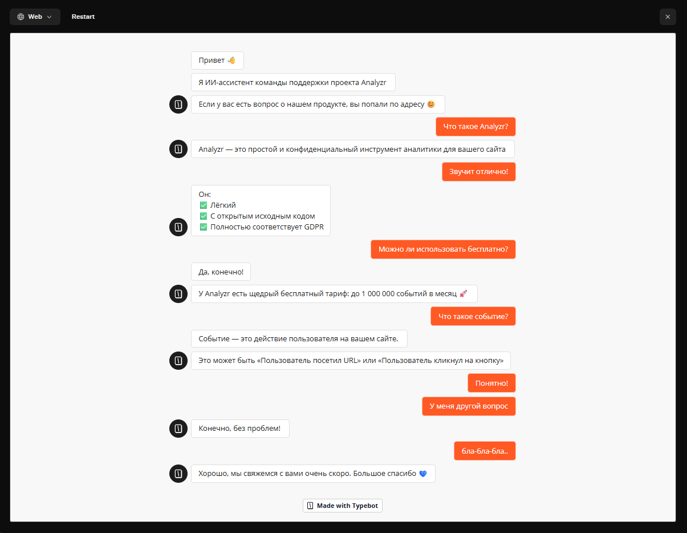
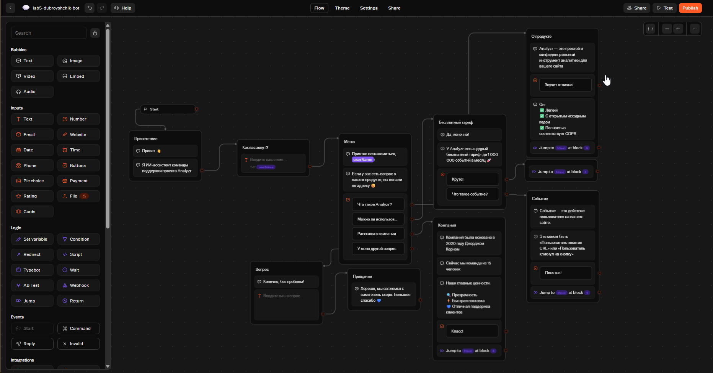
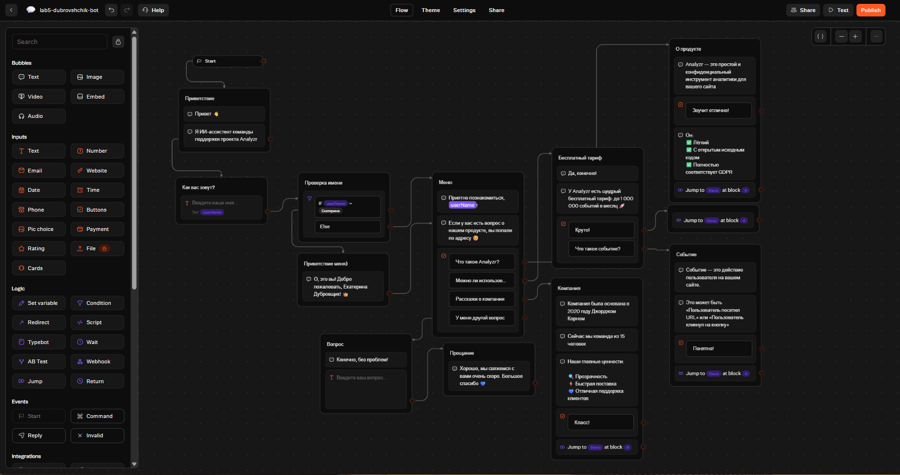
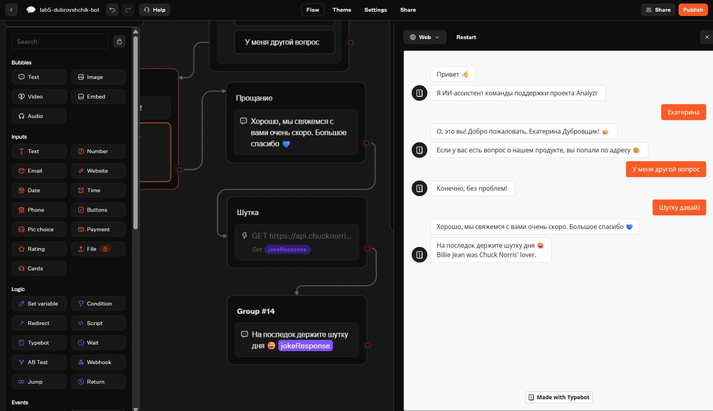
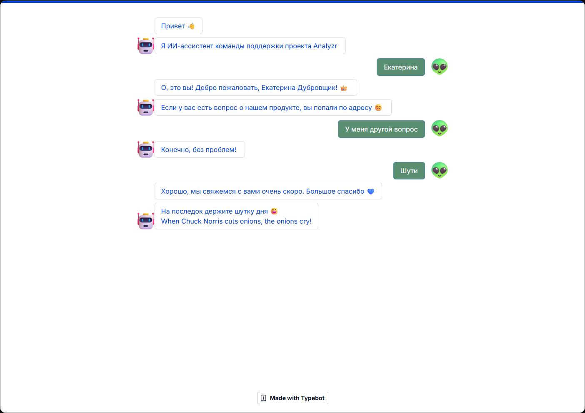
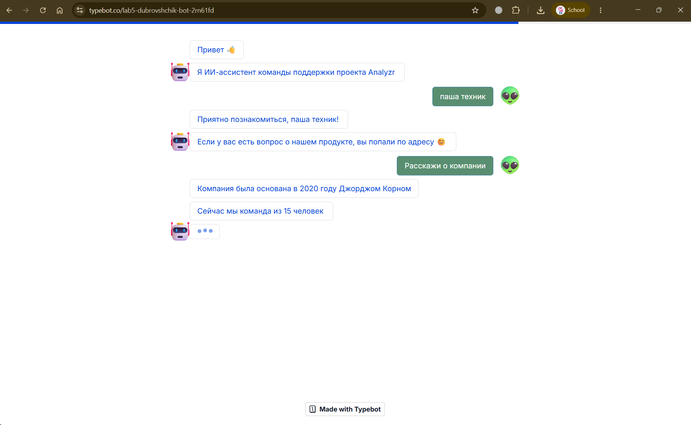

# Отчёт по лабораторной работе №5. Чат-боты

**Платформа:** TypeBot Cloud

**Трек:** C (TypeBot)

**Бот:** `lab5-dubrovshchik-bot`

**Рабочее пространство (workspace):** `lab5-dubrovshchik-ai241`

**Публичная ссылка:** https://typebot.co/lab5-dubrovshchik-bot-2rn61fd

**Экспорт flow:** `exports/lab5-dubrovshchik-bot.json`

## Краткое описание выбранного трека

Выбран трек **C — TypeBot**. Платформа позволяет собирать диалоги из блоков в визуальном редакторе, поддерживает переменные, условия, HTTP-запросы и публикацию в web/Telegram. Для работы выбрана облачная версия TypeBot Cloud (регистрация в браузере, без Docker).

За основу взят готовый шаблон **FAQ** из галереи Templates (бот поддержки продукта Analyzr). Шаблон русифицирован, затем расширен: добавлены переменная, ввод имени, условие, интеграция с внешним API и изменено оформление.

## Что демонстрирует бот

| Блок | Что демонстрирует |
|---|---|
| Приветствие | Стартовое сообщение, обращение к пользователю |
| Ввод имени (Text input) | Сохранение ответа пользователя в переменную `userName` |
| Проверка имени (Condition) | Ветвление `IF userName = Екатерина` / `Else` |
| Меню (Buttons) | Четыре ветки с переходами (Jump to) |
| О продукте / Бесплатный тариф / Событие / Компания | Контентные блоки FAQ |
| Вопрос (Text input) | Свободный ввод вопроса пользователя |
| Прощание | Завершающее сообщение |
| Шутка (HTTP Request) | GET-запрос к `api.chucknorris.io`, вывод поля `value` |

## Использованные AI-промпты (ключевые примеры)

1. **Перевод шаблона:**
   > «Переведи тексты, кнопки, плейсхолдеры и описания шаблона FAQ чат-бота на русский язык, сохранив структуру блоков и переходов.»

2. **Переменная и ввод имени:**
   > «Как в TypeBot создать переменную и сохранить в неё ответ пользователя из блока Text input, чтобы потом подставить её в текст через `{{userName}}`?»

3. **Условие Condition:**
   > «Как в TypeBot настроить блок Condition, чтобы при вводе имени "Екатерина" пользователь шёл по ветке true, а иначе по ветке Else?»

4. **HTTP Request:**
   > «Как в TypeBot через блок HTTP Request сделать GET-запрос к `https://api.chucknorris.io/jokes/random`, сохранить ответ в переменную и вывести текст шутки?»

5. **Путь к вложенному полю:**
   > «Ответ API сохраняется как объект с полем `response`. Как вывести значение `value` из вложенного JSON в TypeBot?»

## Освоенные блоки (ноды)

**Сообщения (Bubbles):**
- `Text` — текст бота
- `Image`, `Video`, `Embed` — мультимедиа (в шаблоне)

**Ввод (Inputs):**
- `Text input` — поле ввода текста (имя, вопрос)
- `Buttons` — кнопки меню

**Логика (Logic):**
- `Condition` — ветвление по значению переменной
- `Set variable` — работа с переменными (`userName`, `jokeResponse`)

**Навигация:**
- `Jump` — переход между блоками

**Интеграции:**
- `HTTP Request` — исходящий GET-запрос к внешнему API

**Переменные:**
- `userName` — имя пользователя
- `jokeResponse` — ответ Chuck Norris API

## Скриншоты

### До русификации (шаблон)
- 

### После русификации
- 

### Проверка логики после перевода
- 

### Переменная и ввод имени
- 

### Условие Condition
- 

### HTTP Request (шутка)
- 

### Смена темы
- 

### Публикация и ссылка
- 

## Ограничения бесплатного тарифа

- Ограниченное число публикуемых typebot в workspace.
- Лимит на количество сообщений/сессий в месяц (зависит от текущего тарифа Free).
- В бесплатной версии на странице бота присутствует брендинг TypeBot («Made with Typebot»).
- Экспорт flow в JSON доступен, однако некоторые продвинутые интеграции (например, кастомные скрипты) могут требовать платного плана.

## Выводы

В ходе выполнения лабораторной работы я освоила TypeBot как low-code платформу для создания чат-ботов. Разобралась с визуальным редактором: как соединять блоки (ноды) стрелками, настраивать переходы (Jump to) и менять тексты.

Изучила работу с переменными: научилась создавать `userName`, сохранять в неё ответ пользователя через блок `Text input` и подставлять значение в текст с помощью синтаксиса `{{userName}}`. Поняла разницу между статичным текстом блока и динамической переменной, которая уникальна для каждой сессии.

Отдельно разобралась с логикой ветвления через блок `Condition`. Настроила проверку `IF userName = Админ`, увидела, как бот перенаправляет пользователя по разным веткам в зависимости от введённых данных.

Самым интересным было настроить интеграцию с внешним API через `HTTP Request`. Я сделала GET-запрос к `api.chucknorris.io` и вывела шутку в чат. Были некоторые трудности, но в целом они решились быстро.

Также я русифицировала готовый шаблон FAQ, проверила, что после перевода не сломались связи между блоками, и изменила тему оформления. Работа с TypeBot показала, как быстро можно собрать рабочего бота без написания кода, но при этом сохранить логику и интеграции.

В общем, как обычно все круто;)