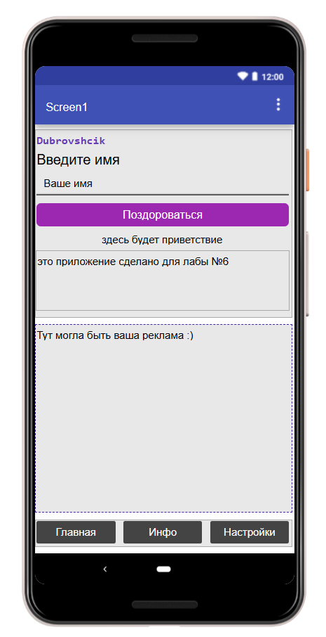
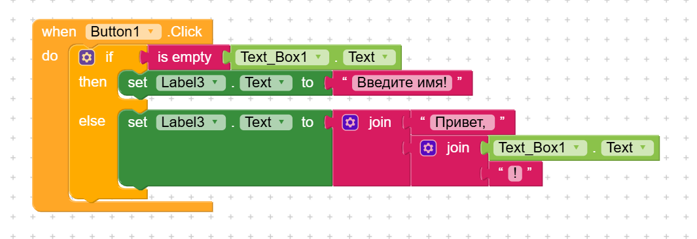

# Отчёт по лабораторной работе №6. Kodular

## 1. Краткое описание базового приложения и ачивок

**Название проекта:** `lab6_dubrovshchik`

**Базовое приложение «Приветствие»:**
Создано приложение, которое запрашивает имя пользователя и выводит персонализированное приветствие. На экране `Screen1` размещены: заголовок, текстовое поле для ввода, кнопка и два лейбла (для результата и с фамилией автора). Логика построена на условном операторе `if/else` и соединении строк (`join`). Если поле пустое — выводится ошибка, если заполнено — приветствие.

## 2. Ссылка на проект

- **Экспортированный файл:** `lab6/exports/lab6_dubrovshchik.aia` (находится в папке `exports/`).

## 3. Использованные AI-промпты (ключевые примеры)

1. **Для базовой логики:**
   > «Как в Kodular сделать так, чтобы при нажатии на кнопку проверялось, пустое ли текстовое поле, и выводилось сообщение?»
2. **Для работы с компонентами:**
   > «Какие компоненты Kodular нужны для сохранения данных между запусками приложения? Приведи пример с TinyDB.»
3. **Для ачивки с уведомлениями:**
   > «Как в Kodular использовать компонент Notifier для показа всплывающего сообщения (Toast) при нажатии на кнопку?»
4. **Для поиска ошибок:**
   > «В Kodular блок TextBox.Text не распознается, выдает ошибку "Component not found". В чем может быть проблема?»

## 4. Освоенные компоненты и блоки

**Компоненты (Designer):**
- `Label` — для вывода текста (заголовки, результат, фамилия).
- `TextBox` — для ввода имени пользователя.
- `Button` — для запуска действия.

**Блоки (Blocks):**
- `when Button.Click do` — событие нажатия на кнопку.
- `if / else` — условное ветвление для проверки пустого поля.
- `join` — соединение строк (например, "Привет, " + имя).
- `set Label.Text to` — запись результата в лейбл.
- `trim` — удаление лишних пробелов из введенного имени.

## 5. Скриншоты всех экранов и логики

### Базовое задание
- 
- 

## 6. Ограничения бесплатного тарифа Kodular

При выполнении работы я не столкнулась с жесткими ограничениями, так как проект небольшой. Однако стоит помнить о лимитах бесплатного тарифа:
- **До 10 проектов** одновременно.
- **До 10 МБ ассетов** (картинок, звуков) на проект.
- **До 5 расширений** (extensions) на проект.
- Для экспорта `.aia` и тестирования приложения не требуется платная подписка.

## 7. Выводы

В ходе выполнения лабораторной работы я освоила платформу Kodular для создания мобильных приложений. Научилась работать с визуальным конструктором интерфейса (Designer) и блочной логикой (Blocks). Поняла, как связывать компоненты и обрабатывать события (например, нажатие на кнопку). 

Также я разобралась с условными операторами и объединением строк, что позволило сделать приложение интерактивным. В рамках ачивок я изучила дополнительные возможности платформы. Опыт работы с Kodular показал, что даже без знания Java или Kotlin можно быстро создать рабочий прототип мобильного приложения.